<div align="center">


# Centra

**Open-Source, Offline-First Personal Finance & Budgeting App for Android, Web, iOS & Desktop**

[](LICENSE)
[](#-download--new-releases-android--desktop)
[](releases/)
[](src/__tests__/)
[](https://capacitorjs.com/)
[](https://supabase.com/)

<br />

<!-- One-Click Direct Download Hero Buttons -->
[-C6FF3D?style=for-the-badge&logo=android&logoColor=000000&labelColor=121212)](releases/Centra-v3.0.0-debug.apk?raw=true)
[-3B82F6?style=for-the-badge&logo=android&logoColor=ffffff&labelColor=121212)](releases/Centra-v2.0.0-debug.apk?raw=true)
[](#-download--new-releases-android--desktop)

<br /><br />

<p align="center">
  <a href="#-download--new-releases-android--desktop"><b>Download APK</b></a> •
  <a href="#-screenshots-gallery"><b>Screenshots</b></a> •
  <a href="#-why-centra-is-open-source-transparency--privacy-guarantee"><b>Privacy & Security</b></a> •
  <a href="#-build-from-source-reproducible-apk-build-guide"><b>Build from Source</b></a> •
  <a href="#-supabase-backend--authentication-setup"><b>Backend Setup</b></a> •
  <a href="#-contributing--license"><b>Contributing</b></a>
</p>

</div>

---

## 📲 Download & New Releases (Android & Desktop)

Clicking any **⬇ Direct Download APK** button below immediately triggers a direct file download of the `.apk` onto your **Android phone** or **Desktop computer (Mac / Windows / Linux)** without leaving GitHub or navigating complex release sub-pages.

| Version | Status | One-Click Direct Download (Android & Desktop) | Mirror (Raw URL) | Size | SHA-256 Checksum | What's New |
|:---|:---|:---|:---|:---|:---|:---|
| **`v3.0.0`** <br>*(Latest)* | 🟢 **Latest Stable** | [**⬇ Download Centra-v3.0.0.apk**](releases/Centra-v3.0.0-debug.apk?raw=true) | [Direct Mirror](https://raw.githubusercontent.com/iqbalhasanshanto-dev/fintech-centra/main/releases/Centra-v3.0.0-debug.apk) | **5.72 MB** <br>_(6,000,321 bytes)_ | `a33c368c1a74a0649e4bf1b5e183186a66b87eae24ffdd091c745ac58b1a1530` | **Full Figma MCP UI Redesign**<br>• Neon Lime (`#C6FF3D`) & OLED Dark / Soft Light themes<br>• Self-hosted `Outfit` font & `৳` Bangla Taka support<br>• Floating `+` Quick Action menu & expandable pickers<br>• 3-card Analytics donut chart & Spending Calendar<br>• Portaled full-screen Notifications & Recent Activities<br>• Native Google PKCE OAuth & 6-digit Email OTP fixes<br>• Android 12+ adaptive splash screen |
| **`v2.0.0`** | ⚪ **Previous Release** | [**⬇ Download Centra-v2.0.0.apk**](releases/Centra-v2.0.0-debug.apk?raw=true) | [Direct Mirror](https://raw.githubusercontent.com/iqbalhasanshanto-dev/fintech-centra/main/releases/Centra-v2.0.0-debug.apk) | **5.44 MB** <br>_(5,700,969 bytes)_ | `74c75d1314b7b45158045f5158595c3ce54726baab1f8822e8b034cdc9820196` | **Core Architecture & Offline Sync**<br>• CentraDB offline-first repository & outbox queue<br>• WebCrypto PBKDF2 local PIN lock (150k iterations)<br>• Session-scoped Guest Demo mode (zero cloud leaks)<br>• Minor-unit integer currency calculation engine<br>• Capacitor 8 & Android 16 (SDK 36) runtime |
| **`v1.0.0`** | 📦 **Prototype Archive** | [**Source Archive (`57007c7`)**](https://github.com/iqbalhasanshanto-dev/fintech-centra/tree/57007c7) | — | — | `Initial Prototype Scaffold` | **Initial Multi-Platform Foundation**<br>• Initial React 18, Supabase & Capacitor prototype<br>• Multi-account balance tracking, budgets & goals<br>• Build from source: `git checkout 57007c7 && npm install && npm run build` |

> 💡 **Detailed evolution of every release is maintained in [`CHANGELOG.md`](CHANGELOG.md) and [`releases/`](releases/).**

### 📱 Android & Desktop Installation Guide

#### On Android Phone:
1. Tap **[⬇ Download Centra-v3.0.0.apk](releases/Centra-v3.0.0-debug.apk?raw=true)** above.
2. Open the downloaded `.apk` file from your browser notification tray or your `Downloads` folder.
3. If Android prompts: *"For your security, your phone is not allowed to install unknown apps from this source"*:
   - Tap **Settings**.
   - Toggle **Allow from this source**.
4. Tap **Install** (or **Update**), then launch **Centra**!

#### On Desktop (Mac / Windows / Linux):
- **Option A (Download APK to Desktop for ADB / Emulator / Phone Transfer)**:
  Click **[⬇ Download Centra-v3.0.0.apk](releases/Centra-v3.0.0-debug.apk?raw=true)** to save the `.apk` directly to your computer.
  - **Install via ADB**: `adb install -r releases/Centra-v3.0.0-debug.apk`
  - **Install in Emulator**: Drag and drop the `.apk` directly onto an open Android Studio Virtual Device (AVD).
  - **Transfer to Phone**: Connect phone via USB or send via local network share.
- **Option B (Run Native Desktop App via Tauri 2 or Web App)**:
  - **Desktop Native App**: Compile standalone desktop binary (`.dmg` on macOS, `.exe` on Windows, `.AppImage` on Linux) with:
    ```bash
    npm run tauri:build
    ```
    Generated binaries are located in `src-tauri/target/release/bundle/`.
  - **Local Web App**: Run `npm run dev` to access the local browser version at `http://localhost:3003`.

### 🔍 How to Verify APK Cryptographic Integrity (SHA-256)

Verify that your downloaded binary is 100% authentic and untampered:

- **macOS / Linux**:
  ```bash
  shasum -a 256 releases/Centra-v3.0.0-debug.apk
  ```
- **Windows (PowerShell)**:
  ```powershell
  CertUtil -hashfile releases\Centra-v3.0.0-debug.apk SHA256
  ```

Matches expected SHA-256 signature:
`a33c368c1a74a0649e4bf1b5e183186a66b87eae24ffdd091c745ac58b1a1530`

<details>
<summary><b>🚀 Maintainer Guide: How to Publish a New Version Update (v3.1.0, v4.0.0, etc.)</b></summary>

Publishing a new Android release to the repository with one-click download links takes 3 simple steps:

1. **Bump Version**: Update `"version"` in [`package.json`](package.json) (e.g. `"version": "3.1.0"`).
2. **Build Android APK**:
   ```bash
   npm run build && npx cap sync android && cd android && ./gradlew assembleDebug && cd ..
   ```
3. **Publish to Releases**:
   ```bash
   npm run release:apk
   ```
   This automated helper script copies `app-debug.apk` to `releases/Centra-v<version>-debug.apk`, computes the exact byte count and SHA-256 checksum, and prints the formatted markdown row ready to paste into `README.md` and `releases/README.md`. All previous APK versions (`v2.0.0`, `v3.0.0`, etc.) remain archived in `releases/` so users can download any release at any time.

</details>

---

## 📸 Screenshots Gallery

<div align="center">

### Home Dashboard & Quick Action Menu
| Dark Theme (`#000000` OLED) | Light Theme (`#F7F8FA` Soft Light) |
|:---:|:---:|
| 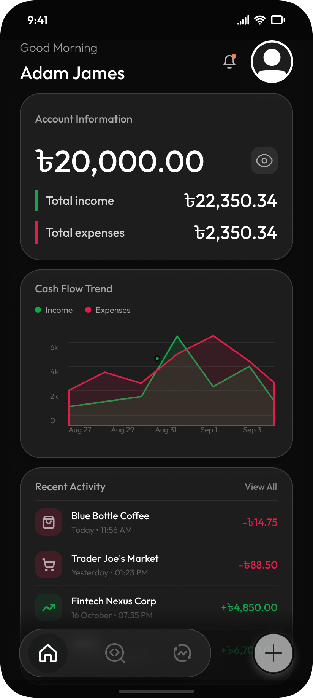 | 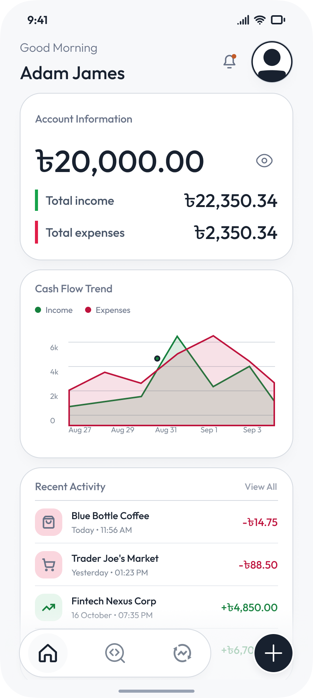 |
| 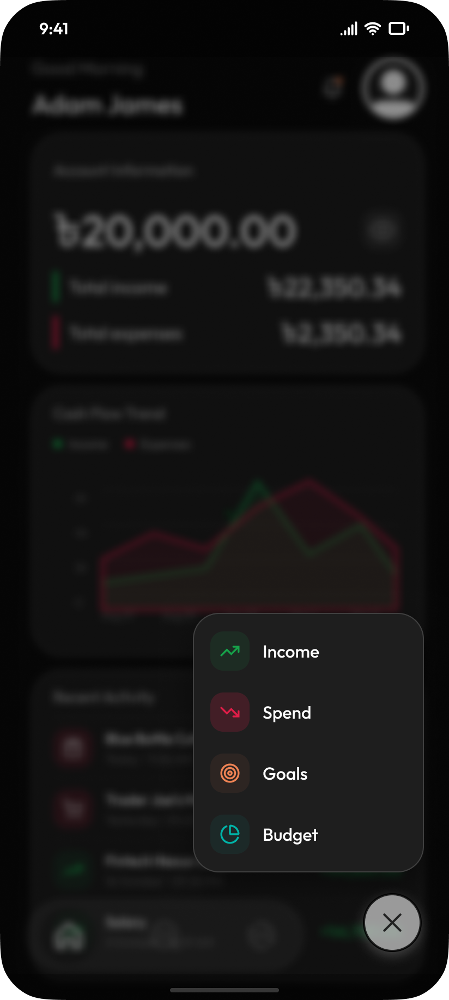 | 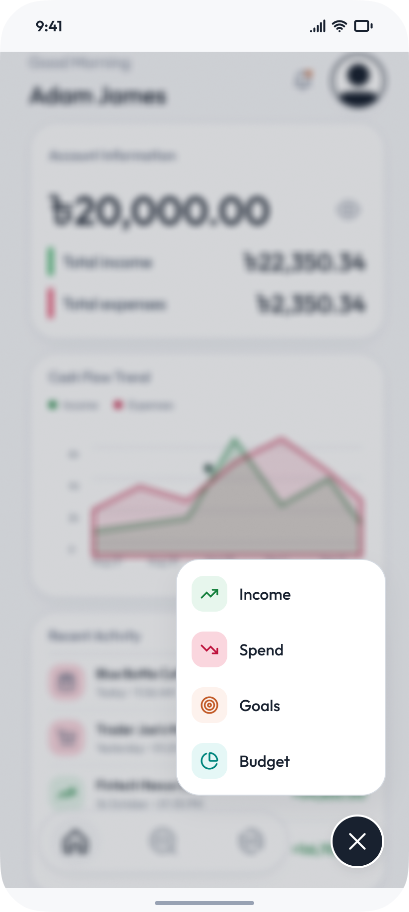 |

### Expense Flow & Category Picker
| Dark Theme | Light Theme |
|:---:|:---:|
| 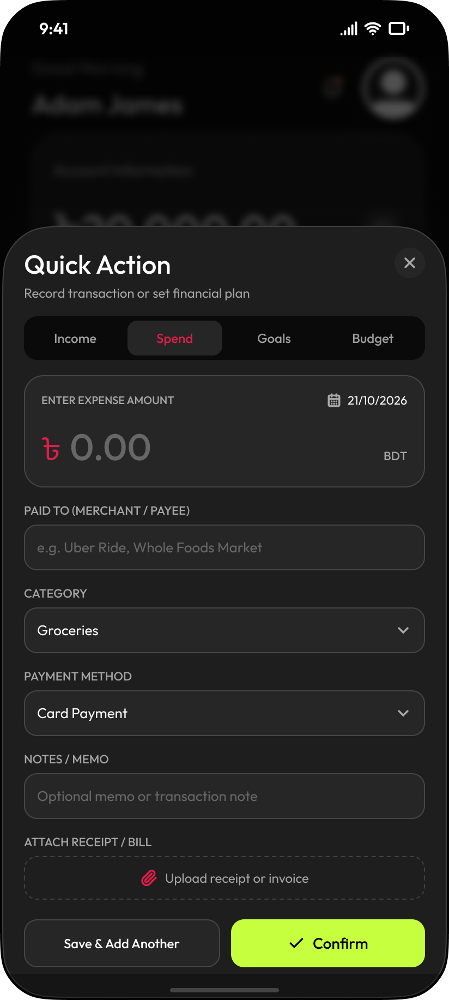 | 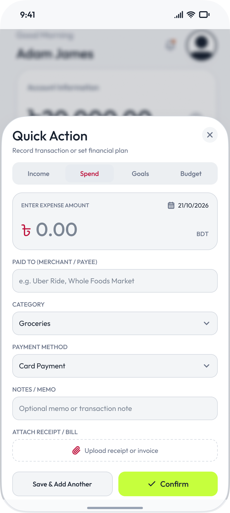 |

### Analytics, Budgets & Settings
| Dark Theme | Light Theme |
|:---:|:---:|
| 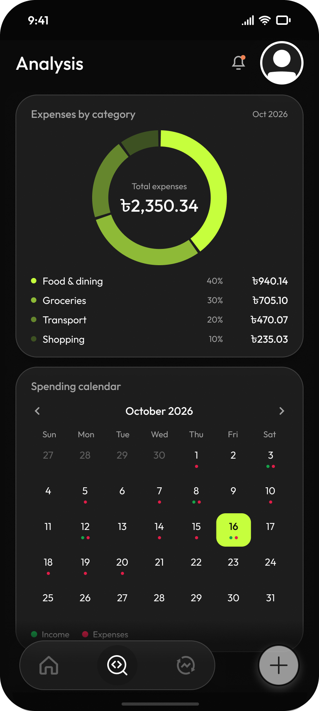 | 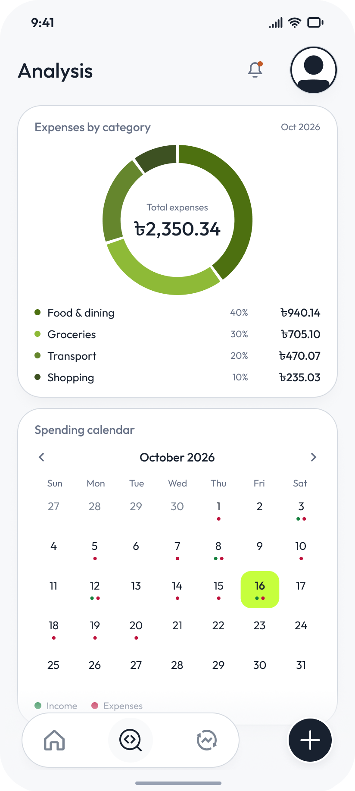 |
| 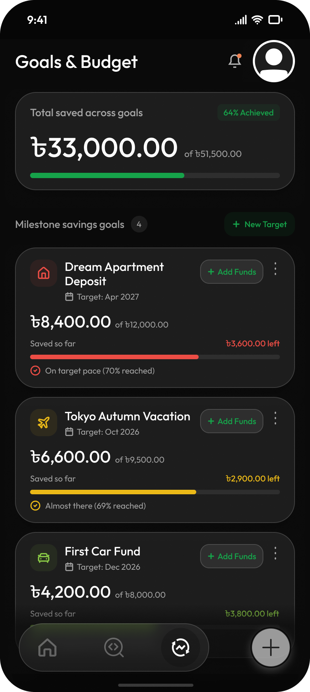 | 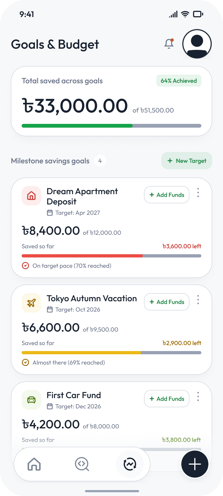 |
| 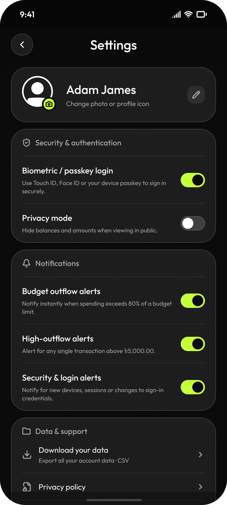 | 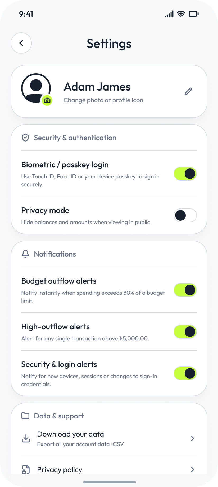 |

</div>

---

## ✨ Why Centra is Open Source (Transparency & Privacy Guarantee)

Your personal financial records belong only to you. Unlike commercial banking and budgeting apps that harvest spending habits, embed intrusive ad tracking, or sell aggregate transaction data, Centra is completely transparent and open-source:

1. **Minimal Android Permission Footprint**:
   Inspect [`android/app/src/main/AndroidManifest.xml`](android/app/src/main/AndroidManifest.xml). Centra only requests:
   - `android.permission.INTERNET` (to sync with your private Supabase database)
   - `android.permission.ACCESS_NETWORK_STATE` (to detect offline mode)
   - **Zero Invasive Permissions**: No contact list access, no background location tracking, no camera/microphone permissions, and no reading of SMS messages or financial OTP notifications.
2. **Local-First & Zero Ad Trackers**:
   Centra contains **no Google Firebase Analytics, no Facebook SDK, no advertising identifiers, and no behavioral telemetry**. All calculations and category classifications execute locally on your device.
3. **Device-Only PBKDF2 PIN Lock**:
   Your 4-digit app lock PIN is hashed locally using browser-standard **WebCrypto PBKDF2** (SHA-256 with 150,000 iterations and a cryptographically secure random salt). The PIN hash and salt remain strictly in your device's local storage; they are **never uploaded to Supabase or included in cloud backups**.
4. **Strict PostgreSQL Row-Level Security (RLS)**:
   Every database query is gated at the database engine level with Supabase RLS. Every table enforces `auth.uid() = user_id`. Even with authenticated database access, no user or third party can read or mutate another user's accounts, transactions, or budgets.
5. **Session-Only Demo Mode**:
   Anyone can test-drive Centra completely offline without creating an account. The guest session stores mock data inside browser `sessionStorage`, automatically purging when closed and never sending a single byte to any remote server.
6. **Air-Gap Data Protection**:
   `android:allowBackup="false"` is enforced to prevent unencrypted cloud backups of local database caches to third-party Android backup services.

For an exhaustive audit of storage topology, physical access considerations, and security boundaries, read [**`docs/DATA_PROTECTION.md`**](docs/DATA_PROTECTION.md) and [**`docs/SECURITY_AUDIT.md`**](docs/SECURITY_AUDIT.md).

---

## 🛠 Tech Stack

| Layer | Technology | Description |
|:---|:---|:---|
| **Frontend Framework** | React 18, TypeScript | Strongly typed UI with declarative state and zero runtime overhead |
| **Styling & Design System** | Tailwind CSS, Outfit Typography | Custom Neon Lime (`#C6FF3D`) design tokens, `@fontsource-variable/outfit`, safe-area insets |
| **Mobile Runtime** | Capacitor 8 | Native Android (SDK 36, AGP 8.13.0) and iOS runtime with deep link handling |
| **Desktop Runtime** | Tauri 2 | Ultra-lightweight Rust backend with native operating system webview engine |
| **Database & Auth** | Supabase (PostgreSQL 15) | Row-Level Security (RLS), PKCE OAuth, 6-digit passwordless Email OTP |
| **Offline Engine** | CentraDB | Client repository with transactional outbox queue and automatic sync on reconnect |
| **Visualizations & Charts** | Recharts, Lucide Icons | Responsive SVG spending donut charts, category distribution, custom spending calendar |
| **Testing Suite** | Vitest, Testing Library, jsdom | Comprehensive unit and integration test suite with **274 passing tests** |

---

## 📁 Repository Structure

```
├── android/                 # Capacitor 8 Android native project (compileSdk 36, AGP 8.13.0)
├── design/                  # Figma design tokens, screen inventory, and layout frames
│   ├── frames/              # Master design export frames (Dark & Light)
│   ├── tokens.md            # Color palette, spacing, and typography tokens
│   └── FRAMES.md            # Complete UI frame documentation
├── docs/                    # Curated open-source documentation
│   ├── DATA_PROTECTION.md   # Storage topology, client caching, and privacy guarantees
│   ├── INPUT_RULES.md       # Input validation inventory, Unicode normalization, and length caps
│   ├── PHASE7_TESTING.md    # Multi-platform QA matrix (Android, iOS, Desktop)
│   ├── README.md            # Documentation directory index
│   ├── SECURITY_AUDIT.md    # Full 13-point security audit and hardening report
│   └── screenshots/         # Side-by-side Dark and Light theme screenshots
├── ios/                     # Capacitor 8 iOS native project (Swift Package Manager)
├── public/                  # Static web assets, logos, and theme-init flash prevention script
├── releases/                # Versioned Android APK releases with SHA-256 verification
│   ├── Centra-v3.0.0-debug.apk
│   ├── Centra-v2.0.0-debug.apk
│   └── README.md
├── scripts/                 # Build and release automation scripts
│   └── prepare-release.mjs  # One-command release packager and SHA-256 calculator
├── src-tauri/               # Tauri 2 desktop application source and Cargo manifest
├── src/
│   ├── __tests__/           # Comprehensive test suite (32 test suites, 274 passing tests)
│   ├── assets/              # Brand icons, logo images, and vector artwork
│   ├── components/
│   │   ├── auth/            # Sign-in, sign-up, 6-digit OTP verification, PIN lock screens
│   │   ├── home/            # Home dashboard, balance summary, quick actions, transaction feed
│   │   ├── layout/          # AppShell, responsive Header, Sidebar, BottomNav
│   │   ├── modals/          # AddActionModal (Spend/Income/Transfer), Category & Account pickers
│   │   ├── onboarding/      # Welcome intro, profile setup, theme selection
│   │   ├── plan/            # Budgets progress bars and savings goals tracking
│   │   ├── report/          # Analytics donut chart, period filters, spending calendar
│   │   ├── settings/        # Currency preferences, PIN management, data export, demo exit
│   │   └── ui/              # Accessible UI primitives (Button, Modal, ConfirmModal, DatePicker)
│   ├── context/             # AuthContext, FinanceContext, ThemeContext
│   ├── db/                  # CentraDB offline repository, outbox sync queue, schema types
│   ├── lib/                 # Supabase client instantiation and platform auth adapters
│   ├── types/               # TypeScript domain interfaces and type definitions
│   └── utils/               # Currency math, sanitizers, logger, native OAuth, PBKDF2 cryptography
└── supabase/
    └── migrations/          # Version-controlled idempotent SQL migrations (00001 to 00008)
```

---

## 🚀 Build from Source (Reproducible APK Build Guide)

Anyone can verify and compile Centra directly from source code on their own machine.

### Prerequisites

- **Node.js**: v20 or newer (`node -v`)
- **JDK**: Java Development Kit 21 (`java -version`)
- **Android Studio**: Android Studio Ladybug (or newer) with Android SDK Platform 36 installed
- **Git**

### 1. Clone & Install Dependencies

```bash
git clone https://github.com/iqbalhasanshanto-dev/fintech-centra.git
cd fintech-centra
npm ci
```

### 2. Configure Environment

Create your `.env` file from the provided template:

```bash
cp .env.example .env
```

Open `.env` and enter your Supabase credentials:

```ini
VITE_SUPABASE_URL=https://your-project-id.supabase.co
VITE_SUPABASE_ANON_KEY=your-supabase-publishable-anon-key
VITE_ENABLE_APPLE_SIGNIN=false
```

> 🔒 **Security Notice**: `.env` is strictly ignored by Git (`.gitignore`). Never commit production secrets.

### 3. Verify Code Quality & Test Suite

Run the full automated test suite and type check:

```bash
# Verify TypeScript compilation (0 errors)
npm run typecheck

# Verify ESLint rules (0 errors, 0 warnings)
npm run lint

# Run all 274 unit & integration tests
npm test
```

### 4. Compile the Android APK

Build the web assets, sync the native Capacitor Android bridge, and compile the debug APK via Gradle:

```bash
# 1. Build production web bundle
npm run build

# 2. Sync web bundle to Android native project
npx cap sync android

# 3. Compile Android debug APK with Gradle
cd android
./gradlew assembleDebug
cd ..
```

The compiled APK will be ready at:
```
android/app/build/outputs/apk/debug/app-debug.apk
```

You can install it directly onto any connected Android device with ADB:

```bash
adb install android/app/build/outputs/apk/debug/app-debug.apk
```

---

## 🗄 Supabase Backend & Authentication Setup

Centra uses Supabase for database storage, Row-Level Security, and authentication.

### 1. Apply Database Migrations

Apply the migration files in [`supabase/migrations/`](supabase/migrations/) in sequential order in your Supabase SQL Editor or with the Supabase CLI (`supabase db push`):

1. `00001_initial_schema.sql` — Profiles, accounts, categories, transactions, goals, budgets, and RLS policies.
2. `00002_rls_security_hardening.sql` — Strict RLS update policies preventing unauthorized privilege escalation.
3. `00003_finance_integrity.sql` — Positive amount validation and constraints.
4. `00004_auth_trigger.sql` — Database trigger automatically creating user profiles on auth signup.
5. `00005_fix_auth_trigger_robustness.sql` — Hardened profile trigger execution.
6. `00006_system_categories.sql` — System categories and default transfer category setup.
7. `00007_transfer_support.sql` — Multi-account transfer support, `converted_amount`, and `exchange_rate` fields.
8. `00008_pro_plan_security.sql` — Pro tier policy guardrails.

### 2. Configure Auth Redirect URLs

In your Supabase Dashboard under **Authentication > URL Configuration**:

- **Site URL**: `http://localhost:3003` (or your deployed web URL)
- **Redirect URLs**: Add both of the following:
  - `http://localhost:3003/**`
  - `com.centra.app://auth/callback` *(required for native Android/iOS Google OAuth and deep links)*

### 3. Configure 6-Digit Email OTP Verification

Centra uses a 6-digit OTP code for instant, passwordless email authentication. Under **Authentication > Email Templates**, edit both **Magic Link** and **Confirm Signup** templates to output the numeric token:

```html
<h2>Your Centra Verification Code</h2>
<p>Enter the following 6-digit code in Centra to proceed:</p>
<h1 style="letter-spacing: 6px; font-family: monospace; font-size: 32px; font-weight: bold;">{{ .Token }}</h1>
<p>This verification code will expire in 10 minutes.</p>
```

> ⚠️ **Production SMTP Note**: Do not use a personal Gmail account for production OTP dispatch. Configure a dedicated transactional email service (e.g., Resend, Postmark, AWS SES, SendGrid) under **Project Settings > Authentication > SMTP Settings**.

---

## 🔒 Protected Features Note: Transfers

The **Transfer** capability (including the Transfer tab in `AddActionModal.tsx`, `transferFunds`, `applyTransferFunds`, transfer branches in `src/utils/financeOperations.ts`, the `'transfer'` system category, and the `converted_amount` / `exchange_rate` database columns) is an active, protected feature designed for multi-account management and cross-wallet rebalancing. It is strictly preserved and must not be deleted or disabled.

---

## 🤝 Contributing & License

Contributions, bug reports, and suggestions from the open-source community are warmly welcomed!

### Contribution Workflow

1. Fork the repository on GitHub.
2. Create a descriptive feature branch (`git checkout -b feature/amazing-feature`).
3. Commit your changes with clear commit messages (`git commit -m 'feat: add amazing feature'`).
4. Ensure all quality checks and tests pass:
   ```bash
   npm run typecheck && npm run lint && npm test && npm run build
   ```
5. Push to your branch (`git push origin feature/amazing-feature`) and open a Pull Request.

### License

This project is licensed under the **MIT License** — see the [LICENSE](LICENSE) file for complete details.

**Copyright (c) 2026 Md. Iqbal Hasan Shanto**
